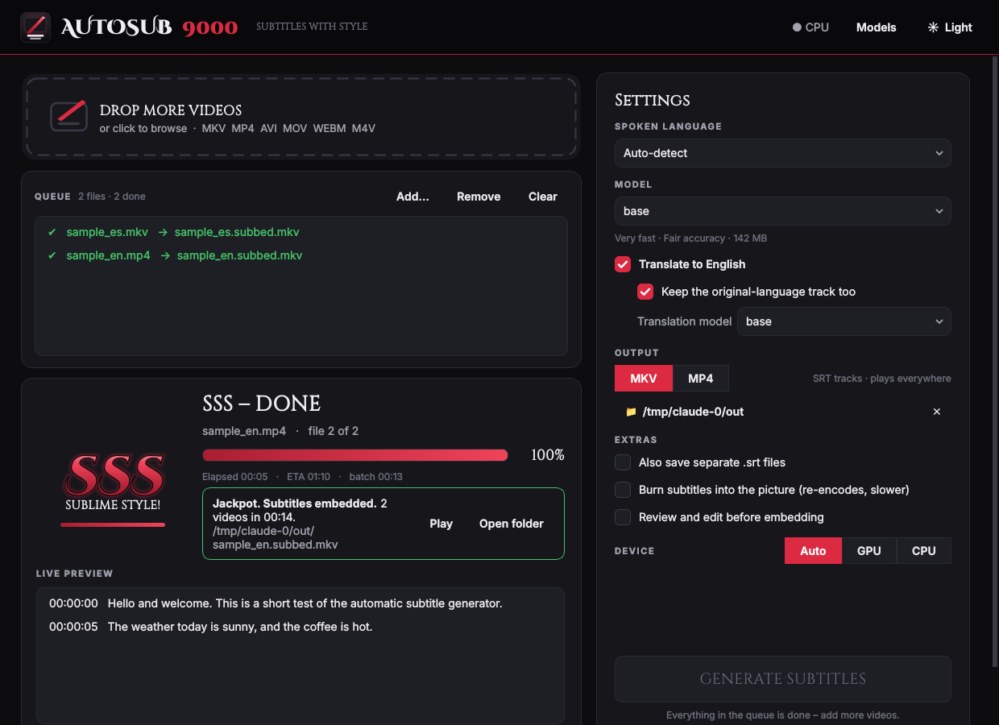
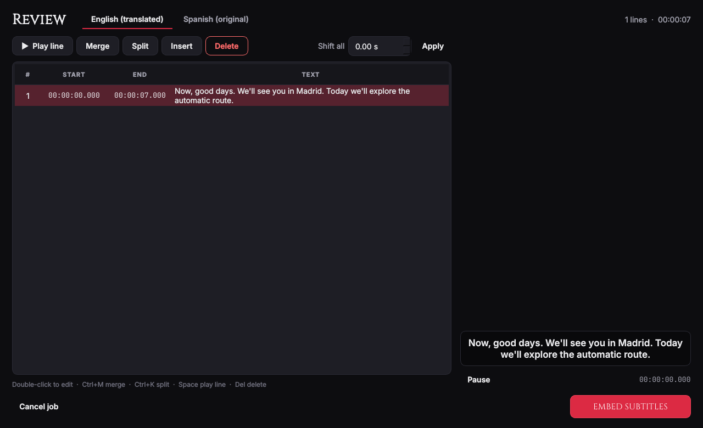

# AutoSub9000

**Subtitles with style. Fully offline.**

AutoSub9000 turns speech in your videos into subtitles with
[whisper.cpp](https://github.com/ggml-org/whisper.cpp). It runs on your GPU through
Vulkan (AMD, Intel or NVIDIA) and falls back to the CPU automatically. It can translate
to English, and it embeds the result as selectable subtitle tracks in a **new copy** of
the video. Your original file is never touched.



- Drag and drop `mkv`, `mp4`, `avi`, `mov`, `webm` or `m4v` files, one or a whole batch.
- Spoken language is auto-detected, or you can choose it.
- **Translate to English** with Whisper's translate task. You can keep the
  original-language track too.
- Soft subtitle tracks with proper language tags (`eng`, `jpn`, …) and titles such as
  *English (translated)* and *Japanese (original)*. English is the default track.
- Video and audio are **stream-copied, never re-encoded**, unless you choose burn-in.
- Optional `.srt` sidecar files and optional burned-in subtitles.
- A review step lets you edit text, fix timings, merge or split lines, and preview the
  video before embedding.
- Progress is shown with stages, a percentage, elapsed time and ETA, a live preview of
  lines as they are produced, and a **style rank** that climbs from D to SSS.
- The CLI uses the same core as the GUI.
- Internet is only used when *you* download a model or click *Check for updates*.
  Nothing checks automatically, and there is no telemetry and no web fonts.

---

## Quick start (AppImage)

```bash
chmod +x AutoSub9000-x86_64.AppImage
./AutoSub9000-x86_64.AppImage                    # start the GUI
./AutoSub9000-x86_64.AppImage --install-desktop  # optional: add it to the app menu
```

On first launch, a setup wizard asks which Whisper models to download. The defaults
are **large-v3-turbo** (transcription) and **large-v3** (translation), about 4.5 GB in
total. Downloads show progress, resume if interrupted, and are verified by SHA-1
checksum. Models are stored in `~/.local/share/autosub9000/models`.

If you already have the official `ggml-*.bin` files, use **Import file…** in the wizard
or the Model Manager. No internet connection is needed for that.

After setup, AutoSub9000 never goes online. When there is no network, the app starts
and works normally. The Model Manager simply shows *"Offline – connect to download more
models."*

### Using it

1. Drop videos on the big drop zone, or click it to browse.
2. Choose the spoken language (or leave it on auto-detect), the model and the output
   format.
3. Tick **Translate to English** if you need it, and **Keep the original-language
   track too** if you want both tracks.
4. Press **GENERATE SUBTITLES**.

The result is saved as `<name>.subbed.mkv` next to the original, or in the output
folder you choose. Your settings and output folder are remembered between sessions.

| Option | What it does |
|---|---|
| MKV (default) | SRT subtitle tracks. Works with any audio/video codec and plays everywhere. |
| MP4 | `mov_text` subtitle tracks, for Apple and TV devices. Fails clearly if the source codecs can't go into MP4. |
| Also save .srt | Writes `<name>.subbed.<lang>.srt` next to the video. |
| Burn in | Draws the English (or only) track into the picture. Re-encodes the video with H.264 (CRF 18), so it is slower. The soft tracks are still added. |
| Review | Opens the subtitle editor before embedding. Untick it to embed straight away. |
| Device | **Auto** uses the GPU if Vulkan works and the CPU otherwise. **GPU** never falls back. **CPU** never uses the GPU. |



### About translation and large-v3-turbo

large-v3-turbo was trained without translation data. With the translate task it often
just transcribes in the original language. If you select it for translation, the UI
shows a warning and AutoSub9000 uses large-v3 or medium instead when one of them is
installed.

### Updating

Open **⋯ → Check for updates…**. If a newer release is on
[GitHub Releases](https://github.com/divinegigas/autosub9000/releases), you'll see
what's new and can **Download & install**. The new AppImage's SHA-256 checksum is
verified, then it replaces your current file in place, so menu entries keep working,
and you can restart into it. Your settings and models are kept. Nothing happens unless
you click.

On the command line: `--check-update` or `--update`.

**Publishing a release** (maintainers): bump `__version__` in `autosub/__init__.py`,
add a section to `CHANGELOG.md` (it becomes the release notes shown in the app), then
`git tag vX.Y.Z && git push origin vX.Y.Z`. The *Release* GitHub Actions workflow builds
the AppImage and publishes it with its `.sha256` file.

### Models

| Model | Size | Speed | Accuracy | Notes |
|---|---|---|---|---|
| tiny | 75 MB | fastest | low | drafts and testing |
| base | 142 MB | very fast | fair | clear speech |
| small | 466 MB | fast | good | all-rounder for slower machines |
| medium | 1.5 GB | moderate | very good | good translation, half the size of large-v3 |
| large-v3 | 2.9 GB | slow | best | **default for translation** |
| large-v3-turbo | 1.5 GB | fast | excellent | **default for transcription**, not for translation |

All of these fit easily in the 12 GB of VRAM on an RX 6700 XT.

---

## Command line

The AppImage and `python -m autosub` accept the same flags. If you pass any flag,
AutoSub9000 runs in CLI mode; with no flags it starts the GUI.

```bash
./AutoSub9000-x86_64.AppImage --input video.mkv
./AutoSub9000-x86_64.AppImage --input video.mkv --translate            # English + original
./AutoSub9000-x86_64.AppImage --input video.mkv --translate --no-keep-original
./AutoSub9000-x86_64.AppImage --input *.mp4 --format mp4 --srt --output-dir ~/Subbed
./AutoSub9000-x86_64.AppImage --input talk.mov --language de --model medium --burn
./AutoSub9000-x86_64.AppImage --input clip.mkv --srt-only               # just .srt files
./AutoSub9000-x86_64.AppImage --list-models
./AutoSub9000-x86_64.AppImage --download-model large-v3-turbo large-v3
./AutoSub9000-x86_64.AppImage --check-gpu
```

Run `--help` for every option, including `--audio-track N` and `--device cpu|gpu|auto`.
The CLI prints the output file paths on stdout and progress on stderr, and its exit code
is non-zero if any file fails. Ctrl+C cancels cleanly.

---

## Troubleshooting

### GPU / Vulkan detection

Run the built-in check first:

```bash
./AutoSub9000-x86_64.AppImage --check-gpu
```

```
whisper-cli:       /tmp/.mount_AutoSu…/usr/bin/whisper-cli
Vulkan module:     present
System libvulkan:  libvulkan.so.1
Vulkan device:     AMD Radeon RX 6700 XT (RADV NAVI22)
Result:            GPU acceleration available ✔
```

The AppImage contains whisper.cpp's Vulkan backend but **not** a GPU driver, because it
uses your system's driver. On Fedora that is Mesa RADV, which is installed by default.
During a job, the header shows **● GPU (…)** in green or **● CPU**, and the log shows
`whisper_backend_init_gpu: using Vulkan0 backend`.

If no device is detected:

1. Check that the Vulkan loader and Mesa driver are installed:
   ```bash
   sudo dnf install vulkan-loader mesa-vulkan-drivers vulkan-tools
   vulkaninfo --summary        # should list "AMD Radeon RX 6700 XT (RADV NAVI22)"
   ```
2. If `vulkaninfo` lists only `llvmpipe`, the AMD driver isn't loaded. Check that the
   `amdgpu` kernel module is in use (`lspci -k | grep -A3 VGA`) and that you are in the
   `video` and `render` groups.
3. If both AMDVLK and RADV are installed, force RADV:
   `AMD_VULKAN_ICD=RADV ./AutoSub9000-x86_64.AppImage`.
4. With several GPUs (for example an iGPU and a dGPU), pick one with
   `GGML_VK_VISIBLE_DEVICES=0` (or `1`).
5. If the GPU is found but a run crashes or produces garbage, set **Device** to **CPU**
   and report your driver version. With Device on Auto, AutoSub9000 already retries a
   failed GPU run on the CPU once. Some driver bugs can be avoided with
   `GGML_VK_DISABLE_COOPMAT=1` or `GGML_VK_DISABLE_F16=1`.

Running on the CPU works everywhere, just more slowly. whisper.cpp picks the best CPU
code path (AVX2, AVX-512, …) for your processor at runtime.

### The AppImage won't start

- `fusermount: not found` / FUSE errors: `sudo dnf install fuse3`, or run it without
  FUSE: `./AutoSub9000-x86_64.AppImage --appimage-extract-and-run`.
- No window on Wayland: try X11 with `QT_QPA_PLATFORM=xcb ./AutoSub9000-x86_64.AppImage`.
  That needs `xcb-util-cursor`: `sudo dnf install xcb-util-cursor`.

### The same line repeats for the rest of the film

This is a known Whisper failure. Normally each 30-second window is decoded with the
previous text as context, so one bad line (often in music or silence) can be copied
forward indefinitely. AutoSub9000 prevents it in two ways:

1. Each window is decoded independently (`--max-context 0`), so a mistake can't
   spread.
2. After transcribing, it looks for runs of identical lines. It re-transcribes each run
   on its own with a stricter repetition check. If that still repeats, it keeps only the
   first copy. You'll see *"Fixing repeated lines"* and a warning when this happens.

Files processed by version 1.0.0 should be run again.

### Other problems

- **"No speech was found"**: the file may have several audio tracks. Try
  `--audio-track 1`, or a larger model.
- **"This video's codec can't go into an MP4 file"**: choose MKV.
- **Wrong language detected**: set the spoken language manually.
- **Out of memory**: use a smaller model, or set Device to CPU.
- For everything else, open the **Log** panel at the bottom of the window (or use
  `--verbose` in the CLI). It shows every ffmpeg and whisper.cpp command and its output.
  The *Copy* button copies the log for bug reports.

Files: settings are in `~/.config/autosub9000/settings.json`, models in
`~/.local/share/autosub9000/models`, and temporary audio in
`~/.cache/autosub9000` (deleted after each job).

---

## Building the AppImage

Install the build dependencies on Fedora:

```bash
sudo dnf install git cmake make gcc gcc-c++ patchelf curl xz tar file \
                 vulkan-headers vulkan-loader-devel glslc
```

Then build:

```bash
packaging/build-appimage.sh
# → dist/AutoSub9000-1.0.0-x86_64.AppImage (about 200 MB)
```

The script:

1. Downloads a pinned **python-build-standalone** CPython 3.12.
2. Installs **PySide6 6.10.1** and trims it: no QML/Quick, no designer tools, and from
   the Addons package only QtMultimedia (for the editor's video preview).
3. Clones **whisper.cpp v1.8.2** (checked against a pinned commit) and builds
   `whisper-cli` with `GGML_VULKAN=ON`. Backends are built as loadable modules
   (`GGML_BACKEND_DL`), so the Vulkan backend is skipped cleanly on machines without
   Vulkan, and all x86-64 CPU variants are included.
4. Adds a **static ffmpeg + ffprobe** (BtbN GPL build, with libass and x264 for burn-in).
5. Adds the app, the bundled fonts, the icon and the `.desktop` file, runs a smoke test,
   and packs everything with `appimagetool`.

Every download is pinned by SHA-256 and cached in `build/downloads`. BtbN replaces its
ffmpeg builds regularly. If the ffmpeg hash check fails, download the new build, check
it, and update `FFMPEG_SHA256` in the script. You can also pass a local file with
`FFMPEG_TARBALL=/path/to/ffmpeg-…-linux64-gpl.tar.xz`.

The AppImage needs glibc 2.34 or newer (Fedora 35+, Ubuntu 22.04+). That floor comes from
the PySide6 wheels and the machine you compile whisper.cpp on. Build on the oldest
distribution you want to support.

## Running from source

```bash
python3 -m venv .venv && . .venv/bin/activate
pip install PySide6-Essentials==6.10.1 PySide6-Addons==6.10.1 pytest
packaging/build-whisper.sh                 # builds whisper-cli into vendor/bin
sudo dnf install ffmpeg-free               # or any ffmpeg/ffprobe on PATH
python -m autosub                          # GUI
python -m autosub --input video.mkv        # CLI
AUTOSUB_MODELS_DIR=~/.local/share/autosub9000/models python -m pytest
```

## Project layout

```
autosub/
  cli.py            command line interface
  config.py         XDG paths + persistent settings
  core/             no Qt in here – shared by GUI and CLI
    pipeline.py     probe → extract → transcribe → translate → review → embed
    media.py        ffprobe + audio extraction (ffmpeg)
    transcribe.py   whisper.cpp runner, live segment/progress parsing, GPU→CPU fallback
    mux.py          ffmpeg stream-copy muxing, tags, default track, burn-in
    subtitles.py    segment model, SRT I/O, merge/split
    models.py       model catalogue, resumable checksum-verified downloads
    languages.py    Whisper language ↔ ISO 639-2 table
    process.py      cancellable subprocess runner
  gui/              PySide6: main window, editor, model manager, setup wizard,
                    theme, custom widgets, background workers
assets/             icon, .desktop file, OFL fonts (Cinzel, Inter, JetBrains Mono)
packaging/          build-appimage.sh, build-whisper.sh, AppRun
tests/              pytest: subtitles, muxing, end-to-end pipeline
```

## Licenses

The bundled fonts are under the SIL Open Font License (see `assets/fonts/OFL-*.txt`).
whisper.cpp is MIT-licensed. The bundled ffmpeg build is **GPL**, so if you
redistribute the AppImage, the GPL applies to that component (its license is included
in the AppImage under `usr/share/licenses/ffmpeg`). Whisper models are MIT-licensed by
OpenAI.
